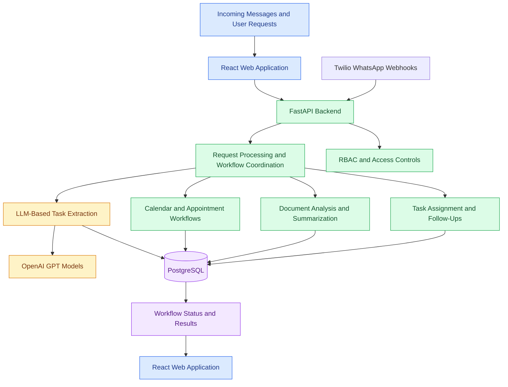

# AI-Powered Digital Assistant

An AI-powered digital assistant designed to streamline government officers' daily workflows through intelligent scheduling, task management, document analysis, meeting coordination, and citizen appointment handling.

The application combines LLM-based information extraction with backend APIs and custom Python workflows to help organize tasks, process incoming messages, and improve operational coordination.

## Overview

Managing appointments, incoming messages, documents, meetings, and follow-up tasks can involve significant manual coordination.

This project explores how AI can help convert unstructured information into actionable tasks, summarize documents, support scheduling, and organize appointment workflows through a centralized web application.

## Key Features

- **LLM-Based Task Extraction:** Extracts actionable instructions and tasks from unstructured messages using OpenAI GPT models.
- **Calendar and Meeting Management:** Supports scheduling workflows, availability checks, reminders, and daily briefings.
- **Document Analysis:** Generates document summaries and extracts important decisions and information.
- **WhatsApp Integration:** Uses Twilio WhatsApp webhooks to receive incoming public messages and connect them to application workflows.
- **Appointment Management:** Supports appointment requests and tracking workflows.
- **Workflow Automation:** Uses custom Python workflows for task assignment, follow-ups, and deadline management.
- **REST API Backend:** Uses FastAPI to support application functionality.
- **Database Integration:** Uses PostgreSQL to store application data.
- **Interactive Web Interface:** Uses React for the frontend.
- **Access Control:** Incorporates role-based access control (RBAC) and data-handling practices aligned with applicable privacy requirements.

## System Architecture

## End-to-End Workflow

### 1. Receive Information

Users interact with the web application. Incoming public messages can also be received through Twilio WhatsApp webhooks.

### 2. Process Requests

The FastAPI backend coordinates requests and routes them to the appropriate application workflow.

### 3. Extract Actionable Tasks

OpenAI GPT models process unstructured messages to identify instructions and potential tasks that require follow-up.

### 4. Manage Scheduling and Appointments

Calendar and appointment workflows support availability, scheduling, reminders, appointment requests, and tracking.

### 5. Analyze Documents

The application processes documents to generate summaries and identify important decisions and information.

### 6. Coordinate Tasks

Custom Python workflows organize task assignment, follow-ups, deadlines, and related activities.

### 7. Persist Application Data

PostgreSQL stores relevant application information and workflow data.

### 8. Return Results

The web application presents workflow information, task status, summaries, and appointment details to users according to their access permissions.

## Technology Stack

| Category | Technologies |
|---|---|
| Programming Language | Python |
| Backend Framework | FastAPI |
| LLM Integration | OpenAI GPT models |
| Frontend | React |
| Database | PostgreSQL |
| Messaging Integration | Twilio WhatsApp Webhooks |
| Workflow Orchestration | Custom Python Workflows |
| Security | Role-Based Access Control (RBAC) |

## Reported Project Outcomes

- **1,000+ messages:** Reported message volume used in the task-extraction workflow.
- **Approximately 85% instruction recognition:** Reported instruction-recognition result.
- **Approximately 40% less manual coordination:** Reported reduction associated with workflow automation.
- **Approximately 30% faster appointment response turnaround:** Reported result during testing.

*These figures should be presented as measured results only when you can explain the evaluation method and supporting evidence in an interview.*

## Potential Use Cases

- Organizing tasks extracted from incoming messages.
- Summarizing documents and identifying important decisions.
- Coordinating meetings, appointments, and reminders.
- Tracking assigned tasks and follow-up deadlines.
- Connecting incoming WhatsApp messages to application workflows.

## Future Improvements

- Add a documented API setup and usage guide.
- Introduce automated tests for task extraction and appointment workflows.
- Evaluate extraction accuracy using a representative labeled dataset.
- Add workflow monitoring, error handling, and audit logging.
- Improve access controls and data-retention policies.
- Provide sanitized screenshots or a demonstration, if authorized.

## Security and Privacy

This project concerns government-oriented workflows and public communications. Do not publish real citizen messages, personal data, government documents, credentials, internal URLs, private source code, or confidential architecture details.

Use synthetic examples and sanitized screenshots. Describe privacy and regulatory alignment accurately, and claim formal compliance only when it has been verified.

## Project Summary

This project demonstrates the application of **LLM-based information extraction, workflow automation, backend API development, document analysis, scheduling, and messaging integration** to administrative workflows.
